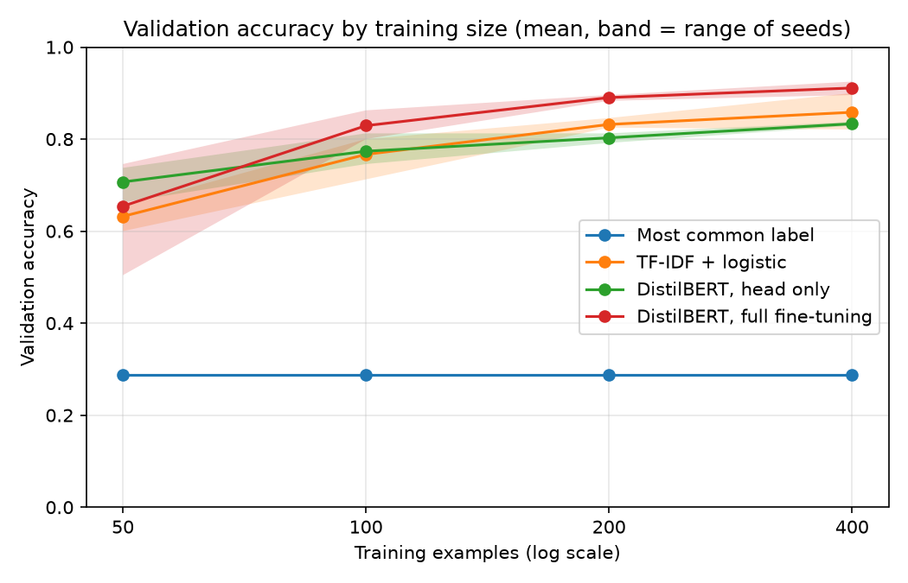
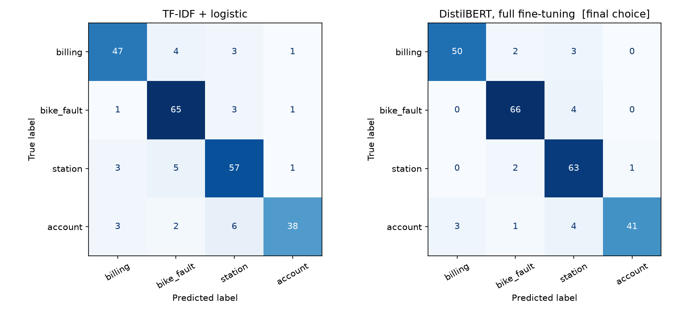

# Lakeshore Ticket Sorter: fine-tuning against a baseline

Model: https://huggingface.co/YOUR-HF-USERNAME/lakeshore-ticket-sorter
Space: https://huggingface.co/spaces/YOUR-HF-USERNAME/lakeshore-ticket-sorter

## What it does

Lakeshore Bike Share sorts short support messages into four queues: `billing`,
`bike_fault`, `station` and `account`. This project asks whether fine-tuning a
pretrained model (DistilBERT) is worth it when only a few hundred labelled messages
exist. It compares two ways of fine-tuning against two cheap baselines on the same
rows, over three seeds and four training sizes, and publishes the fine-tuned model
with a Gradio demo.

## How to run it

```bash
# 1. environment (Python 3.12, CPU PyTorch)
conda env create -f environment.yml
conda activate lab09-fine-tune-and-publish
python -c "import torch, transformers, gradio; print(torch.__version__, transformers.__version__, gradio.__version__)"
python pin_versions.py   # pins requirements*.txt and space/requirements.txt

# 2. the whole comparison: tuning, the grid, then the final check (writes reports/)
#    the first run downloads distilbert-base-uncased (~270 MB); the grid takes
#    roughly 30-60 minutes on a laptop CPU
python run_experiments.py --quick       # 1-minute smoke test, writes quick_reports/
python run_experiments.py               # or one stage at a time: --stage tune|grid|final

# 3. the app, locally (loads the model/ folder the final stage saved)
python app.py

# 4. checks
python -m ruff format --check .
python -m ruff check .
python -m pytest
```

The `model/` folder (about 250 MB) is not committed. `python run_experiments.py
--stage final` recreates it from the same rows and seed.

## Data and split

`tickets_data.py` (given, unchanged) creates 1,200 invented messages with
`make_tickets()` and its default arguments. About one message in eight is vague and
says nothing about its topic, and about one in ten mixes two topics, so no model can
reach 100%. `prepare.py` splits the rows once, before anything is fitted, into a
stratified 60/20/20 split (720 / 240 / 240, seed 42). `small_sample()` draws a
stratified sample of 50, 100, 200 or 400 rows from the training part only, with
seeds 0, 1 and 2. The test rows and my 40 own messages are read only in the final
stage.

## Methods

| Method | What is trained | Settings |
|---|---|---|
| Most common label | nothing | predicts the commonest training label |
| TF-IDF + logistic | word and word-pair TF-IDF, logistic regression | C = TODO |
| DistilBERT, head only | the new head (~0.6 M parameters), body frozen | lr = TODO, epochs = TODO |
| DistilBERT, full | all ~67 M parameters | lr = TODO, epochs = TODO |

Fine-tuning uses a hand-written loop (`finetune.py`): AdamW with weight decay 0.01,
linear warm-up over the first 10% of steps then decay to zero, gradient clipping at
1.0, batch size 16, messages truncated at 64 tokens and padded per batch with
`DataCollatorWithPadding`. The seed is set before the model is built, so it controls
the head's starting weights, dropout and the batch order; the sample uses the same
seed.

**How the settings were chosen.** `run_experiments.py --stage tune` tried, at 400
training rows with seed 0, scored on the validation rows only:
TF-IDF C in {1, 10}; head-only lr in {1e-3, 3e-3} x epochs in {5, 10}; full
fine-tuning lr in {3e-5, 5e-5} x epochs in {3, 5}. Every try is in
`reports/tuning.csv` and the winners in `reports/settings.json`. The same settings
were then used at every size.

**Fairness.** At each size and seed, all four methods are trained on exactly the same
sampled rows and scored on the same 240 validation rows. One thing could not be made
equal: the fine-tuned models had a small grid of settings tried, while TF-IDF had
only two values of C.

## Results

Validation accuracy, mean and range over three seeds (from `reports/summary.csv`):

| Training rows | Most common | TF-IDF + logistic | Head only | Full fine-tuning |
|---|---|---|---|---|
| 50 | TODO | TODO | TODO | TODO |
| 100 | TODO | TODO | TODO | TODO |
| 200 | TODO | TODO | TODO | TODO |
| 400 | TODO | TODO | TODO | TODO |



**Final choice** (rule decided in advance: highest mean validation accuracy at 400
rows): TODO. Scored once on the 240 test rows, each method trained on the same 400
rows (seed 0):

| Method | Test accuracy | Test macro F1 |
|---|---|---|
| Most common label | TODO | TODO |
| TF-IDF + logistic | TODO | TODO |
| DistilBERT, TODO | TODO | TODO |



Every run is in `reports/results.csv`, every epoch's training loss and validation
accuracy in `reports/training_log.csv`, and the final numbers in `reports/final.json`.

## Your own 40 messages

`data/own_messages.csv` holds 40 messages I wrote myself, ten per queue, with varied
length and a few spelling slips. They were never used for training or for choosing
settings, and were scored once in the final stage.

| Method | Accuracy | Macro F1 |
|---|---|---|
| Most common label | TODO | TODO |
| TF-IDF + logistic | TODO | TODO |
| DistilBERT, TODO | TODO | TODO |

TODO: one or two sentences — does this match the test result, or does the
generated data flatter the models?

## Publishing

`share.py` saves the fine-tuned model (the better fine-tuned variant on validation)
and writes its model card from `reports/final.json`. `publish.py` uploads `model/` to
the model repository and `space/` to a Gradio Space, using the login from
`hf auth login`. No token is stored in this repository. The Space (`space/app.py`)
loads the model by its Hub id, returns a score for every queue, and shows a clear
message when the text box is empty.

```bash
hf auth login            # once, on your own computer
python publish.py
```

## Tests

`python -m pytest` runs 22 tests (about 2-4 minutes on a CPU, using tiny samples and
one epoch). They check that the split has the right sizes with no overlap (for four
seeds), the small-sample function, that TF-IDF beats the most common label,
truncation and labels in tokenization, that freezing leaves only the head trainable
and head-only training leaves every body weight unchanged, that full fine-tuning
changes the body, that the same seed repeats a run, that the model can memorize
eight messages, that a saved model reloads with the same prediction, that the model
card has the required parts, and that the app returns scores for all four queues
that sum to one and a clear error for empty text.

## Limitations

- The training text is invented and repeats a small set of sentence patterns.
- About 12% of messages are vague, so their label cannot be known from the text;
  this caps every method at roughly 0.9.
- Three seeds give a rough range, not a confidence interval.
- Settings were tuned at 400 rows only and reused at smaller sizes.
- Only English, short messages were tested.
